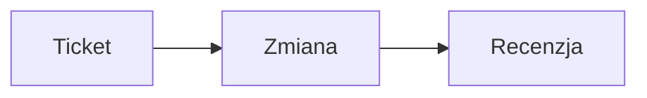

## Block catalog

A post is built from two kinds of blocks.

**Text blocks** are ordinary markdown with a convention on top: `callout`, `quote`, `figure`, `code`, `heading`, `footnotes`. The markdown twin keeps them unchanged.

**Container blocks** wrap markdown between an opening line `:::name` and a closing line `:::`: `faq`, `steps`, `stats`, `compare`, `details`, `gallery`, `video`, `cta`, `glossary`, `chart`, `diagram`, `terminal`, `graphic`. Rules shared by all containers:

- The opening line is `:::name`, optionally followed by attributes in the form `key="value"` (double quotes are required). The `details` block takes a plain title instead of attributes.
- The closing line is `:::` alone on its line.
- Containers do not nest. A container that is never closed stays ordinary text.
- A `:::` line inside a fenced code block is code, not a marker.
- A container whose content does not have the expected shape falls back to ordinary markdown. Nothing is lost, only the block look.
- An empty container renders nothing.

### `callout`

An alert box. Use it for the TL;DR at the top of the post and for a note, tip or warning the reader must not miss. It is a blockquote whose first line is the alert marker. The alert types are `[!NOTE]`, `[!TIP]`, `[!IMPORTANT]`, `[!WARNING]`, `[!CAUTION]`, `[!TLDR]` and `[!QUOTE]` (a highlighted quote without a title). The marker is case-insensitive.

```markdown
> [!TLDR]
> - Lint sprawdza wpis przed publikacją.
> - Błędy blokują publikację, ostrzeżenia nie.

> [!WARNING]
> Cofnięcie publikacji wyłącza adres wpisu i jego wersję markdown.
```

### `quote`

A quotation with its author. Use it for the words of a person or a source. It is a blockquote whose last line starts with two hyphens and a space, followed by the author. A blockquote without that line stays an ordinary quote.

```markdown
> Dokumentacja, której nikt nie czyta, jest kosztem, a nie wartością.
> -- Anna Kowalska, liderka zespołu
```

### `figure`

An image with a caption. Use it when the image needs a visible caption. It is an image alone in its paragraph, with a title in double quotes; the title becomes the caption. The alt text describes the image (at least 11 characters).

```markdown

```

### `code`

A code listing with a copy button. Use it for commands, configuration and code. It is a fenced code block; the language comes first, and an optional `title="..."` shows a file name above the listing.

````markdown
```python title="przyklad.py"
print("Cześć")
```
````

### `heading`

Section headings. Every heading of level 2 to 4 gets an anchor built from its text, so a reader can link to a section, and the page builds its table of contents from the H2 and H3 headings. The title of the wiki page is the H1 of the post; write the sections as H2 (two `#` characters) and subsections as H3. The example shows a subsection; an H2 uses the same syntax with two `#` characters.

```markdown
### Jak uruchomić lint z terminala?
```

### `footnotes`

Footnotes. Use them for a source or a remark that would break the sentence. Put the reference `[^label]` in the text and the definition `[^label]: text` on its own line anywhere in the post. The footnotes are numbered in the order of the references and listed at the end of the page.

```markdown
Wyszukiwanie w wiki działa semantycznie[^1].

[^1]: Wyszukiwanie korzysta z osadzeń wektorowych treści stron.
```

### `faq`

Questions and answers. Use it for the questions readers really ask. Each question is an H3 line inside the container and the text below it is the answer. The page gets question and answer structured data, and the headings inside this block are not checked by the heading rules of the lint.

```markdown
:::faq
### Czy lint zmienia wpis?
Nie, lint tylko czyta treść i zwraca listę problemów.

### Czy każdy problem blokuje publikację?
Blokują tylko błędy, ostrzeżenia i informacje nie.
:::
```

### `steps`

A numbered procedure. Use it when the order matters. It is a numbered list; a bold start of an item is the name of the step, and the rest is its description. The page gets step structured data.

```markdown
:::steps
1. **Zapisz szkic** Utwórz stronę wiki jako prywatną.
2. **Uruchom lint** Popraw wszystkie błędy z raportu.
3. **Pokaż podgląd** Podaj autorowi adres podglądu szkicu.
:::
```

### `stats`

Key numbers. Use it for two to four figures that carry the message. Every line is a list item in the form `- **value** - label`; a line in another form turns the whole block into ordinary markdown.

```markdown
:::stats
- **99%** - dostępność usługi w ostatnim kwartale
- **24/7** - monitoring adresów URL
:::
```

### `compare`

A comparison table. Use it to set options side by side. It is a markdown table; the optional attribute `highlight="N"` marks column number N (counted from 1) as the recommended one.

```markdown
:::compare highlight="2"
| Cecha | MCP | CLI |
| --- | --- | --- |
| Dla kogo | agent AI | człowiek w terminalu |
| Wynik | tekst i pola | tabela albo JSON |
:::
```

### `details`

A collapsible section. Use it for content that most readers skip: long logs, edge cases, derivations. The title is the rest of the opening line, without quotes; without a title the section is labelled "Szczegóły".

```markdown
:::details Pełna lista zmiennych środowiskowych
Zmienne opisuje plik konfiguracyjny projektu.
:::
```

### `gallery`

A grid of images. Use it for several screenshots that belong together. The container holds images only; any other text turns it into ordinary markdown. Every image needs a descriptive alt text (at least 11 characters), as everywhere in the post.

```markdown
:::gallery


:::
```

### `video`

An embedded video. The first line is the address, the rest is the description of what the video shows. Supported addresses use `https` and point at YouTube (`https://www.youtube.com/watch?v=<id>`, `https://youtu.be/<id>`) or Vimeo (`https://vimeo.com/<id>`). The player loads only after the reader clicks. Another `http` or `https` address is shown as a plain link below the description.

```markdown
:::video
https://www.youtube.com/watch?v=dQw4w9WgXcQ
Nagranie pokazuje konfigurację projektu krok po kroku.
:::
```

### `cta`

A call to action. Use it once, at the end of the post. It holds one or more paragraphs of text and exactly one link, which becomes the button. More than one link, or other content, turns the block into ordinary markdown.

```markdown
:::cta
Chcesz sprawdzić, jak agent pracuje na Twoim projekcie?

[Załóż projekt w Monolynx](https://example.com)
:::
```

### `glossary`

A list of terms. Use it when the post introduces vocabulary. Every line is a list item in the form `- **term** - definition`.

```markdown
:::glossary
- **Lint** - automatyczne sprawdzenie wpisu przed publikacją
- **Bliźniak markdown** - wersja wpisu dla modeli AI pod adresem z końcówką .md
:::
```

### `chart`

A chart drawn from a table. Use it when the numbers form a comparison or a trend. The attribute `type` is `bar`, `line` or `pie`, and `title` is the caption. The content is a markdown table with labels in the first column and numbers in the next ones. The table stays on the page as the data of the chart, so the text source is never lost. A block without such a table is a lint error.

```markdown
:::chart type="bar" title="Liczba ticketów w sprincie"
| Status | Liczba |
| --- | --- |
| Zrobione | 10 |
| W toku | 4 |
:::
```

### `diagram`

A Mermaid diagram with a description. Use it for a flow or a structure. The attribute `title` is the caption. The content is a paragraph that describes the diagram in words, followed by a fenced block in the language `mermaid`. Both are required by the lint: a reader that does not render Mermaid reads the description.

````markdown
:::diagram title="Obieg pracy nad ticketem"
Ticket trafia do agenta, agent otwiera zmianę, a po recenzji zmiana trafia do głównej gałęzi.

:::
````

### `terminal`

A terminal window. Use it for a session: a command together with its output. The attribute `title` is the window title. The content is one fenced block that is not empty; an empty or missing block is a lint error.

````markdown
:::terminal title="Lint wpisu"
```
$ monolynx blog lint 3f2a9c1e
Ocena: 100/100
```
:::
````

### `graphic`

A ready-made graphic component from the repository, chosen by name. The attribute `name` must be one of the registered names; the registry currently holds `agent-loop`. The content is a paragraph that describes the graphic in words: it is the text shown to readers without the component and the only thing the markdown twin keeps. An unknown name or a missing description is a lint error. A new graphic is added by a change in the repository, not by the author of a post.

```markdown
:::graphic name="agent-loop"
Schemat pokazuje obieg: ticket trafia do agenta, agent otwiera zmianę, a wynik trafia do wiki.
:::
```
